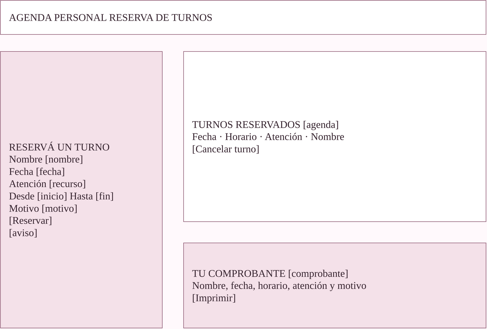
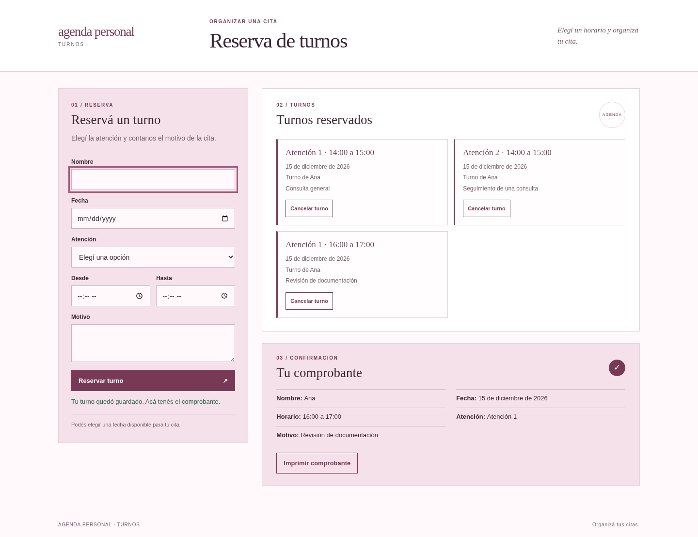

# Reserva de turnos

## 🧩 Datos generales

| Campo | Detalle |
| --- | --- |
| Integrante 1 | Julieta Ini |
| Integrante 2 | No corresponde: trabajo individual |
| Modelos de IA utilizados | ChatGPT; GPT-6 Luna |
| Tecnologías del proyecto | HTML5, CSS3, JavaScript, Markdown y GitHub |
| Link del repositorio | https://github.com/juliini2/turnos-club-estudio |

## Descripción

Agenda personal para elegir una atención, organizar una cita y reservar un horario. Permite consultar turnos, evitar superposiciones según las reglas existentes, cancelar reservas y obtener un comprobante. Los recursos previos siguen siendo válidos y se muestran con etiquetas genéricas.

## Uso

Completá Nombre, Fecha, Desde, Hasta, Atención y Motivo. La agenda presenta los turnos y permite consultar su comprobante o cancelarlos. La información continúa guardándose con el mecanismo local existente en este navegador.

## Encargo registrado

Registro original del desarrollo; los prompts se conservan tal como se utilizaron.

> Implementá Ronda de encuentros para Club Entre Líneas en index.html/style.css/script.js. Boceto: formulario vertical en columna izquierda angosta; agenda arriba derecha y comprobante debajo. Ciruela #783957, rosa #f4e1e9, fondo #fff9fc, títulos Georgia, sans serif para campos, líneas finas. IDs nombre, fecha, recurso, inicio, fin, motivo, aviso, agenda, comprobante, formulario-reserva. Recursos Mesa de lectura y Taller de ejercicios. Guardar con localStorage propio, listar ordenado, cancelar y mostrar comprobante solo si guardó. Rechazar vacíos, fecha inexistente, fin no posterior a inicio y cruces en igual recurso/día (nuevoInicio<finExistente && nuevoFin>inicioExistente). Permitir consecutivos y recursos distintos simultáneos; fechas pasadas válidas para ejercicios. Datos inválidos o almacenamiento bloqueado: aviso; nunca anunciar guardado si falló. Ocultar comprobante al rechazo o cancelación de su reserva. Imprimir solo comprobante vigente. Datos como texto seguro. Móvil320px, campos de hora100px mínimo, foco visible y labels; exportar lógica para pruebas Node.

## Corrección de validaciones

La prueba de lógica mostró que se aceptaban horas como 25:00. La lectura de datos guardados también comprobaba tipos de campos, pero no si una fecha existía.

> Validá horas entre 00:00 y 23:59. Al leer localStorage, descartá reservas con fecha, horario, recurso o campos inválidos antes de dibujar la agenda y avisá si se descartaron datos. Evitá que una fecha corrupta bloquee toda la pantalla.

### Identificadores de la pantalla

La prueba en navegador detectó dos elementos con `id="inicio"`: el título y la hora inicial. La etiqueta del campo podía apuntar al elemento equivocado.

> Reservá el ID inicio para el campo horario. Cambiá el ancla del encabezado a portada y actualizá su enlace, de forma que todos los IDs sean únicos.

### Agenda abierta en dos pestañas

Una prueba con dos pestañas mostró que la segunda podía reemplazar una reserva cargada por la primera. También se detectó que una lista almacenada con reservas superpuestas se aceptaba completa.

> Volvé a leer la agenda guardada antes de reservar o cancelar, para trabajar con los cambios más recientes de otra pestaña. Escuchá los cambios de almacenamiento y actualizá la lista. Al cargar, conservá solo reservas válidas sin duplicados ni cruces entre ellas.

**Resultado comprobado:** se rechazó el cruce creado desde la segunda pestaña y se conservaron ambas reservas cuando los horarios eran consecutivos. La carga descarta registros superpuestos o duplicados.

## Estado

Cambios locales. Publicación pendiente por decisión del usuario.

## Capturas actuales

Boceto de la interfaz:

Aplicación funcionando con datos de ejemplo:

[Ver captura móvil](evidencias/aplicacion-movil.png).

[Comprobante de ejemplo en PDF](evidencias/comprobante.pdf).

Estas capturas corresponden a la versión local. El repositorio y el sitio publicados todavía conservan la versión anterior.
